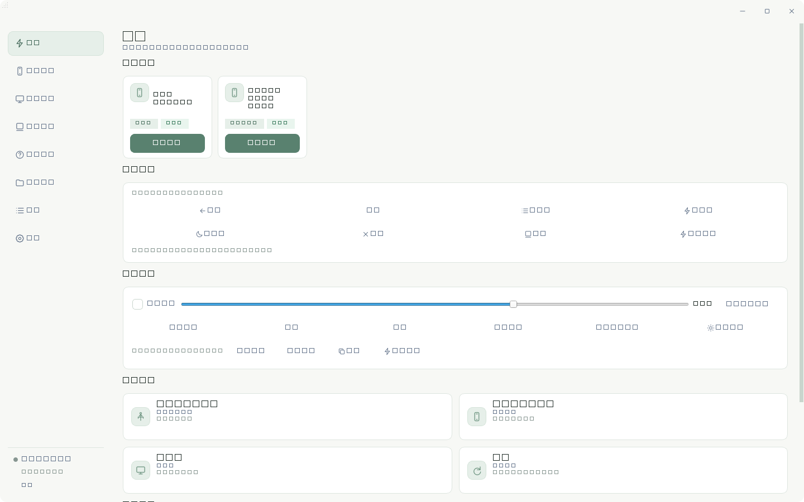
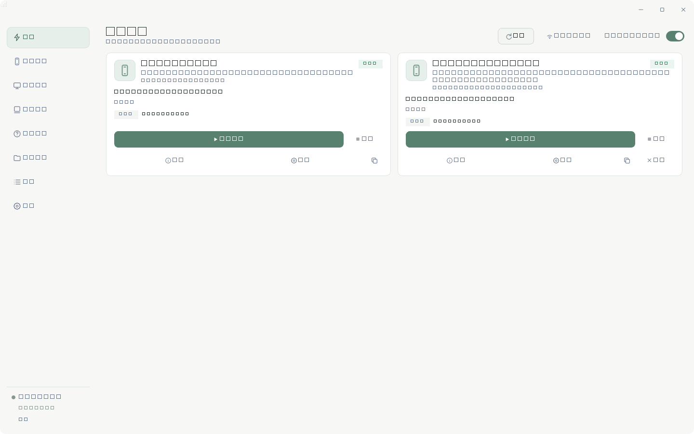
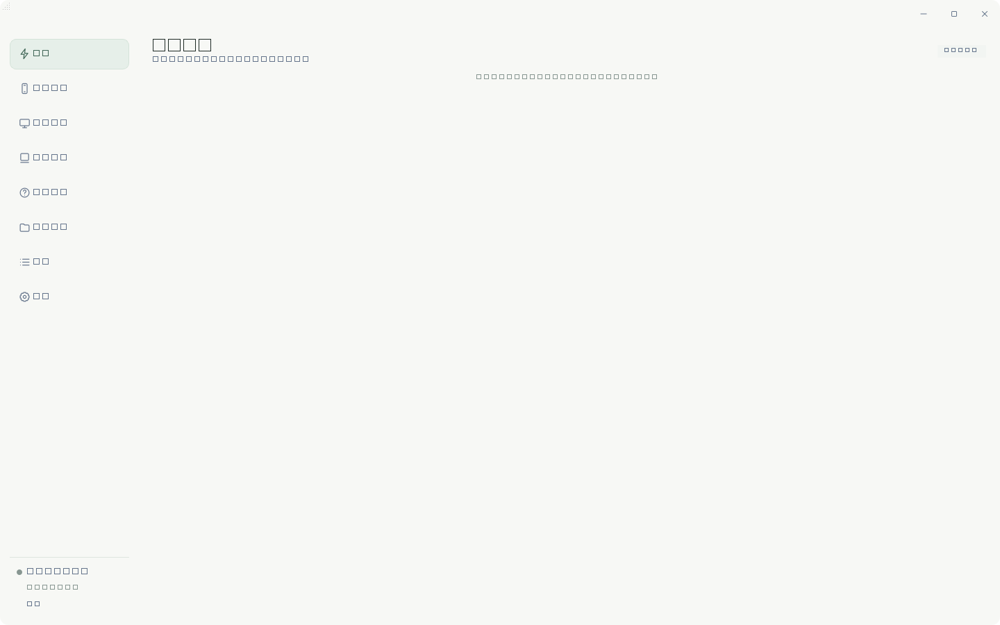
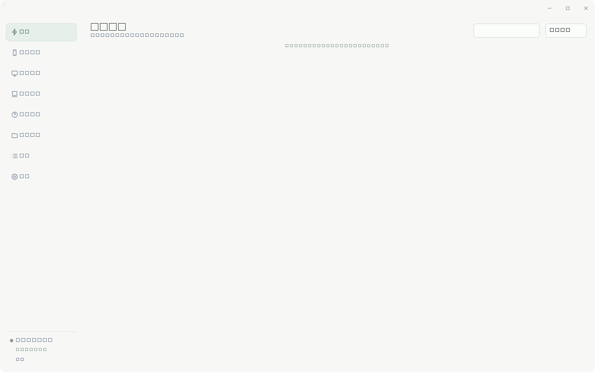
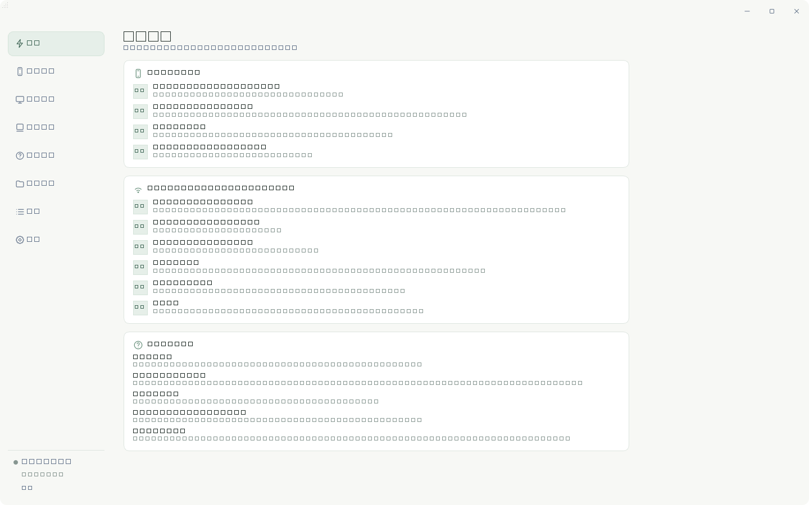
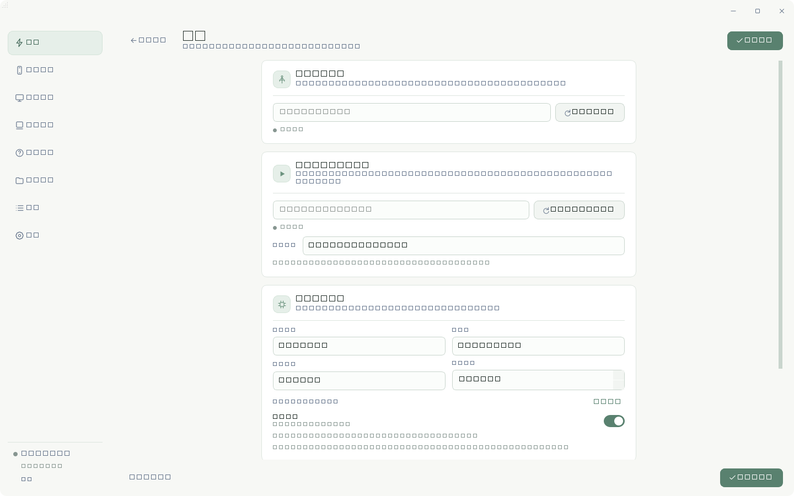

# SmartCast

<p align="center">
  
</p>

<p align="center">
  一款基于 <b>Python + PySide6 + ADB + scrcpy</b> 的 Windows Android 投屏与设备管理工具
</p>

<p align="center">
  
  
  
  
</p>

---

## 目录

- [简介](#简介)
- [功能特性](#功能特性)
- [界面预览](#界面预览)
- [快速开始](#快速开始)
- [使用指南](#使用指南)
- [项目结构](#项目结构)
- [技术架构](#技术架构)
- [开发与测试](#开发与测试)
- [打包发布](#打包发布)
- [常见问题](#常见问题)
- [兼容性与限制](#兼容性与限制)
- [致谢](#致谢)
- [许可证](#许可证)

---

## 简介

SmartCast 是一个面向 Windows 的 Android 设备投屏与管理工作台。它把 **ADB 设备连接**、**scrcpy 投屏**、**手机控制**、**屏幕调节**、**截图录屏** 整合进同一个界面，并针对多设备场景做了完整隔离：

- 每一台设备都通过 **ADB serial** 独立标识、独立配置、独立投屏；
- USB 与 Wi-Fi（ADB TCP/IP）设备统一管理；
- 所有 ADB 命令在后台线程执行，界面不会卡死。

与直接用命令行跑 `scrcpy` 相比，SmartCast 额外提供：设备信息与编码器能力检测、硬件编码器优先的自动参数推荐、多会话状态中心、截图/录屏归档管理，以及一键安装包。

## 功能特性

### 设备连接

- **USB 设备**：插入即自动扫描识别，读取型号、Android 版本、分辨率、DPI。
- **Wi-Fi 设备**：手动输入 `IP:PORT`（支持整段粘贴 `192.168.1.23:5555`），或只填 IP + 端口。
- **局域网扫描**：自动探测本机 /24 子网的常用 ADB 端口（5555–5560），并直连最近连接过的历史地址（可覆盖 Android 11+ 的随机端口）。
- **连接校验**：`adb connect` 返回成功不算数，还会二次核对 `adb devices` 状态并做 shell 探活，才会认定连接成功。
- **精确断开**：只断开指定的 `IP:PORT`，不影响其他 USB / Wi-Fi 设备与正在进行的投屏。
- **状态识别**：`device` / `offline` / `unauthorized` / `disconnected` 分别呈现，未授权、离线、超时、连接被拒绝（10061）、超时（10060）、端口被占用（10013）都有独立提示。

### 投屏

- 按 serial 独立启动 / 停止，支持 **多台 USB + 多台 Wi-Fi 同时投屏**。
- 自动检测设备可用编码器，**硬件编码器优先**，并给出码率建议。
- 每个设备可独立保存编码、分辨率、帧率、码率、音频设置，互不覆盖。
- 支持 **熄屏投屏**（`--turn-screen-off`）：手机屏幕关闭，电脑画面照常。
- 支持 **全屏切换**：直接控制 scrcpy 窗口，不修改手机设置。
- 投屏期间自动放缓设备扫描，减少资源占用。

### 手机控制

- 一键 **返回 / 主页 / 多任务 / 音量+ / 音量− / 静音 / 锁屏 / 电源菜单 / 唤醒**。
- 所有命令严格携带设备 serial，多设备同时在线也不会串台。
- 投屏窗口下方提供**悬浮控制条**，跟随窗口移动，操作时不会抢走投屏窗口焦点。

### 屏幕控制

- **亮度**：滑块调节、自动亮度开关、一键恢复原始亮度。
- **旋转**：自动旋转 / 强制竖屏 / 强制横屏。
- **常亮**：临时把休眠时间设为无限，并可恢复原始值。
- 所有修改前都会记录设备原始设置（按设备持久化到 `devices.json`），可随时手动恢复。
- 厂商 ROM 拒绝修改时会给出明确错误，而不是静默失败。

### 投屏中心

- 统一展示所有会话：设备名、USB / Wi-Fi 标识、状态、**实时运行时长**、实际使用的编码器 / 码率 / 分辨率 / 帧率。
- 单会话独立停止、全屏，不影响其他会话。
- 会话状态与 ADB 在线状态相互独立（设备离线 ≠ 投屏进程已退出）。

### 媒体管理

- **截图**：通过 `adb exec-out screencap` 获取原始 PNG 字节流，避免文本模式解码损坏图像。
- **录屏**：使用 scrcpy 的 `--no-window --record`，停止时正常收尾保证 mp4 可播放。
- 文件按设备型号分目录存放，型号名经过安全清洗，不会出现非法路径字符。
- **历史记录持久化**，支持按设备 / 类型筛选，打开文件、打开目录、删除记录、删除文件（二次确认，删记录与删文件互不影响）。
- 文件被用户手动删除时，历史记录会标记为“缺失”而不是报错。

### 其他

- 浅色主题（跟随系统窗口圆角的无边框界面）、自定义标题栏、右下角缩放。
- 内置“使用指南”页面，覆盖 USB 与 Wi-Fi 两种连接方式。
- 运行日志页面，支持查看、清空、导出。
- 选项框 / 数字框**禁用鼠标滚轮**，避免浏览页面时误改参数。

## 界面预览

### 首页



### 设备管理



### 投屏中心 / 媒体管理

<p align="center">
  
  
</p>

### 使用指南 / 设置

<p align="center">
  
  
</p>

## 快速开始

### 方式一：安装包（推荐给普通用户）

1. 下载 `SmartCastSetup.exe`；
2. 双击运行，阅读并同意许可协议；
3. 选择安装位置（默认 `C:\Program Files\SmartCast`，可勾选仅当前用户免管理员）；
4. 完成后从开始菜单或桌面快捷方式启动。

卸载：Windows「设置 → 应用」中搜索 SmartCast 即可卸载，会一并清理快捷方式。

### 方式二：源码运行（开发者）

环境要求：**Windows 10 / 11 64 位**、**Python 3.11+**。

```powershell
git clone https://github.com/Cecil-gw/smartcast.git
cd smartcast

python -m venv .venv
.\.venv\Scripts\activate

pip install -r requirements.txt
python main.py
```

> 项目已内置 `adb.exe` 与 `scrcpy` 运行文件（`resources/`），无需另行安装。
> 如需使用系统自带的 ADB / scrcpy，可在「设置 → 工具路径」中指定。

## 使用指南

### USB 连接

1. 使用**支持数据传输**的 USB 线连接手机；
2. 手机开启「开发者选项 → USB 调试」；
3. 弹出授权弹窗时勾选「始终允许」并确认；
4. SmartCast 自动识别设备，在设备卡片上点「开始投屏」。

### Wi-Fi 连接（ADB TCP/IP）

> 注意：`adb connect IP:5555` 适用于**已开启 TCP/IP ADB** 的设备，不等同于 Android 11+ 的「无线调试配对」。

1. 让手机开启 ADB 网络调试。最常见方式：先用 USB 连接一次，执行 `adb tcpip 5555` 后拔线；
2. 确认手机与电脑处于**同一局域网**；
3. 设备管理页点「网络连接设备」；
4. 输入 `192.168.1.23:5555` 这样的完整地址，或只填 IP 再单独填端口；
5. 不确定 IP 时点「扫描局域网」；
6. 连接成功后卡片会以 Wi-Fi 标识出现，点「开始投屏」即可。

Android 11+ 的「无线调试」端口是随机的（如 `39401`），全子网扫描无法发现；但**连接过一次之后地址会被记住**，下次扫描会优先直连，秒级恢复。

### 手机控制 / 屏幕控制

- 首页「手机控制」面板：设置当前主设备后可直接发送按键；
- 首页「屏幕控制」面板：亮度、旋转、常亮、恢复；
- 投屏运行后，投屏窗口下方会出现**两行悬浮控制条**（按键 + 屏幕控制）。

### 截图 / 录屏

在首页「屏幕控制」面板或悬浮控制条上：

- 点「截图」→ 保存到 `SmartCast/screenshots/设备型号/`；
- 点「录屏」→ 开始无声录制；再点一次「停止录屏」→ 保存到 `SmartCast/recordings/设备型号/`；
- 到侧边栏「媒体管理」中查看历史、打开文件或目录。

## 项目结构

```
SmartCast/
├── main.py                     # 应用入口
├── SmartCast.iss               # Inno Setup 安装包脚本
├── requirements.txt
├── core/                       # 业务核心（无 UI 依赖）
│   ├── adb_manager.py          # ADB 执行封装（serial 隔离、shell、devices）
│   ├── adb_network_manager.py  # 无线连接 / 断开 / 状态校验 / Server 恢复
│   ├── network_scanner.py      # 局域网多端口扫描 + 历史地址直连
│   ├── device_info.py          # 设备模型与 USB / Wi-Fi 类型识别
│   ├── device_control.py       # 手机按键 + 屏幕控制 + 原始设置备份
│   ├── encoder_detector.py     # 编码器能力检测
│   ├── parameter_optimizer.py  # 码率建议（硬件编码优先）
│   ├── cast_session.py         # 投屏会话模型与时长格式化
│   ├── scrcpy_manager.py       # scrcpy 进程 / 窗口 / 会话生命周期
│   └── media_manager.py        # 截图、录屏、媒体历史
├── workers/                    # QThread 后台任务
│   ├── device_worker.py        # 定时设备扫描
│   ├── detection_worker.py     # 编码器检测线程
│   ├── control_worker.py       # 手机控制命令
│   ├── screen_worker.py        # 屏幕控制命令
│   ├── media_worker.py         # 截图 / 录屏
│   ├── network_worker.py       # 无线连接 / 断开 / 扫描 / ADB Server
│   └── tool_check_worker.py    # 工具可用性检测
├── ui/
│   ├── main_window.py          # 主窗口与信号总线
│   ├── theme.py                # 主题与样式表
│   ├── icons.py                # 内置 SVG 图标
│   ├── components/             # 卡片、标题栏、控制条、面板等复用组件
│   └── pages/                  # 首页 / 设备 / 投屏中心 / 媒体 / 设置 / 指南 / 日志
├── utils/
│   ├── config_manager.py       # settings.json + devices.json
│   ├── system_utils.py         # 工具路径解析、命令执行
│   └── logger.py
├── resources/
│   ├── adb/                    # 内置 ADB
│   ├── scrcpy/                 # 内置 scrcpy 及依赖
│   └── assets/                 # 应用图标
├── tests/                      # 单元测试 + UI 冒烟测试
└── docs/                       # 使用、架构、开发文档
```

## 技术架构

### 分层

```
UI 层 (PySide6 Widgets)
   │  Signal / Slot
   ▼
Worker 层 (QThread)          ← 所有耗时 ADB 操作在这里执行
   │
   ▼
Core 层 (纯 Python)          ← 可直接单元测试，无 Qt 依赖（scrcpy 除外）
   │
   ▼
adb.exe / scrcpy.exe
```

### 关键设计

| 主题 | 做法 |
|---|---|
| 设备标识 | 统一使用 ADB serial（USB 为硬件序列号，Wi-Fi 为 `IP:PORT`），贯穿扫描、配置、投屏、控制、媒体 |
| 命令执行 | 全部经由 `AdbManager.shell(serial, ...)`，**永不**使用不带 `-s` 的全局命令 |
| 线程安全 | 每类操作独立 QThread；同设备同类操作防重入；worker 内部兜底捕获异常，保证信号必达 |
| 配置隔离 | `devices.json` 以 serial 为键，保存每台设备的投屏参数与屏幕原始设置 |
| 窗口控制 | 通过进程 PID 定位 scrcpy 窗口（不依赖窗口类名），实现全屏与悬浮控制条跟随 |
| 二进制处理 | 截图使用 `exec-out screencap -p` 字节流，绕开文本模式解码 |
| 计时 | 会话时长用 `time.monotonic()` 计算，UI 定时器仅刷新显示，不触发任何 ADB 命令 |

## 开发与测试

```powershell
# 全量单元测试
python -m unittest discover tests -p "test_*.py"

# 编译检查
python -m compileall core ui workers utils main.py

# UI 冒烟测试（无头）
$env:QT_QPA_PLATFORM='offscreen'
$env:PYTHONPATH='.;vendor'
python tests\ui_refactor_smoke.py
python tests\home_layout_smoke.py
python tests\main_window_network_smoke.py
```

测试约定：

- 全部使用 mock 隔离真实 ADB / scrcpy，不依赖真机；
- 覆盖正常路径、异常路径、QThread 生命周期、重复操作与设备隔离；
- 不使用降低断言的方式换取通过。

详见 [docs/DEVELOPMENT.md](docs/DEVELOPMENT.md)。

## 打包发布

```powershell
# 1. 生成 onedir 程序
python -m PyInstaller --noconfirm --windowed --name SmartCast `
  --icon resources\assets\app-icon.ico `
  --add-data "resources;resources" main.py

# 2. 生成安装包（需先安装 Inno Setup 6/7）
& "C:\Program Files\Inno Setup 7\ISCC.exe" SmartCast.iss
```

产物：`dist\SmartCastSetup.exe`（含许可协议页、安装路径选择、开始菜单与桌面快捷方式、控制面板卸载入口）。

## 常见问题

**连不上 Wi-Fi 设备？**
依次检查：是否同一局域网 → 手机 ADB 网络调试是否开启 → 端口是否正确 → Windows 防火墙是否拦截（错误码 10013）。

**设备显示「未授权」？**
在手机的开发者选项中「撤销 USB 调试授权」，重新连接并在弹窗中允许。

**设备显示 offline？**
网络抖动或休眠导致。恢复 Wi-Fi 后重新连接即可，设备的独立投屏配置不会丢失。

**亮度调节报错？**
部分 Android 11+ 机型由厂商策略保护 `screen_brightness`，ADB 无法修改，属于系统限制。

**录屏没有声音？**
当前录屏使用 `--no-audio`，仅录制画面，避免各厂商音频权限差异导致录制失败。

## 兼容性与限制

- 仅支持 **Windows**（依赖 `CREATE_NO_WINDOW`、Win32 窗口 API）；
- 内置 **scrcpy 5.0.1**，`--turn-screen-off`、`--record` 等参数以该版本为准；
- 暂不支持 Android 11+ 无线调试的**配对码流程**（`adb pair`）；
- 暂不支持 mDNS 自动发现、USB 一键切换 Wi-Fi、公网远程连接；
- 悬浮控制条、全屏切换依赖 Win32 窗口 API，仅在 Windows 下生效；
- 录屏为无声录制，且无法在已有投屏会话中动态开启（scrcpy 版本限制）；
- 不同厂商 ROM 对按键事件、亮度、旋转设置的响应存在差异，操作失败会如实提示。

## 致谢

- [scrcpy](https://github.com/Genymobile/scrcpy) — Apache License 2.0
- [Android Platform Tools (ADB)](https://developer.android.com/tools/releases/platform-tools) — Apache License 2.0
- [PySide6 / Qt](https://www.qt.io/qt-for-python) — LGPL v3

## 许可证

本项目采用 [MIT License](LICENSE) 发布。第三方组件的许可证见各组件目录下的 `LICENSE` / `NOTICE` 文件。
